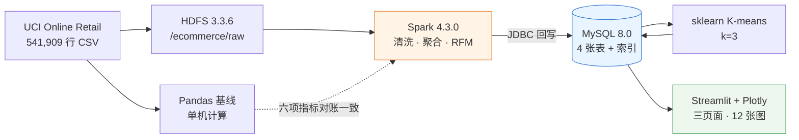

# 电商客户价值分析 · RFM + K-means

> 《大数据技术》课程设计 ｜ Hadoop HDFS + Spark + MySQL + Streamlit 全链路实现

对一个英国在线零售商 **541,909 条真实交易流水**（2010-12 ~ 2011-12）做客户价值分析：
原始数据存入 HDFS → Spark 分布式清洗与聚合 → MySQL 落库 → RFM 建模 + K-means 分群 →
Streamlit 三页面交互系统呈现。分布式结果与 Pandas 单机基线**逐项对账一致**。

---

## 核心结果

| 指标 | 数值 |
|---|---|
| 原始记录 | 541,909 行 |
| 清洗后（交易口径） | 536,641 行 |
| 有效购买（客户口径） | 391,153 行 |
| 总销售额 | £8,737,227.64 |
| 订单数 | 18,402 |
| 客户数 | 4,334 |
| 前 20% 客户贡献 | **74.58%** 销售额 |
| Q4 月均销售额 | 比全年均值高 **31.08%** |
| 聚类方案 | k=3，轮廓系数 0.3387 |

**三群结构**

| 客户群 | 人数 | 占比 | 销售额贡献 |
|---|---:|---:|---:|
| 重要价值客户 | 748 | 17.26% | **67.81%** |
| 一般发展客户 | 1,710 | 39.46% | 24.49% |
| 一般挽留客户 | 1,876 | 43.29% | 7.70% |

> 近一半客户只贡献不到 8% 的销售额——这是典型的帕累托结构，也是分群运营的立足点。

---

## 技术架构



**为什么用 Spark 而不是纯 Pandas？** 课程要求分布式处理链路。Spark 承担全量清洗、
月度/商品/国家聚合与 RFM 汇总，最终与 Pandas 结果对账，证明分布式实现正确。
聚类留在单机（4,334 行），因为 sklearn 调参和可解释性更好。

---

## 目录结构

```
graduation_project/
├── README.md                       本文件
├── requirements.txt                Python 依赖（固定版本）
├── 部署与启动说明.md                新机部署 5 步 + 常见问题
├── 1_start_hdfs.bat                HDFS 启停（1 / 9）
├── 2_spark_smoketest.bat           Spark 冒烟测试
├── 3_run_full_etl.bat              全链路 ETL
├── 4_open_dashboard.bat            静态看板（离线兜底）
├── 5_restore_mysql.bat             恢复数据库
├── 6_open_streamlit.bat            交互网页（推荐演示）
├── 8_fill_info.bat                 一键填署名声成 PDF
└── ecommerce_rfm/                  项目本体
    ├── app.py                      Streamlit 三页面主程序（539 行）
    ├── .streamlit/config.toml      主题与端口
    ├── scripts/                    01~15 按步骤编号的处理脚本
    ├── docs/                       报告 / 答辩 PPT / 运行手册 / 表结构说明
    └── outputs/                    结果 CSV、三张截图、看板 HTML、演示录屏
```

**不纳入版本管理的内容**（体积过大或可重新生成，已在 `.gitignore` 中排除）：

| 目录 | 体积 | 说明 |
|---|---|---|
| `bigdata/` | 2.5 GB | Hadoop 3.3.6 + Spark 4.3.0 + JDK，自行下载 |
| `python_env/` | 1.4 GB | 项目专用虚拟环境，用 requirements.txt 重建 |
| `ecommerce_rfm/data/` | 134 MB | UCI 原始数据，见 [数据获取说明](ecommerce_rfm/docs/数据获取说明.md) |
| `db_backup/` | 118 MB | MySQL 转储，可用脚本重新导出 |

---

## 快速开始

### 路线 A：只想看分析和图表（5 分钟）

```bash
pip install pandas numpy matplotlib scikit-learn
python ecommerce_rfm/scripts/03_clean.py       # 清洗
python ecommerce_rfm/scripts/05_rfm.py         # RFM
python ecommerce_rfm/scripts/07_kmeans.py      # 聚类
```

结果落在 `ecommerce_rfm/outputs/`：RFM 明细、分群结果、选 k 评估表。
也可以直接看 `outputs/dashboard/客户价值分析看板.html`（浏览器打开，无需环境）。

### 路线 B：跑交互网页（推荐演示）

```bash
pip install -r requirements.txt
# 需要先有 MySQL 里的数据，见 docs/运行手册.md
streamlit run ecommerce_rfm/app.py
```

浏览器打开 `http://localhost:8501`，三页面：销售概览 / 客户价值分析 / 客户分群。
支持日期、国家、RFM 区间、客户号、分群多级筛选，结果可导出 CSV。

### 路线 C：跑完整大数据链路

见 [部署与启动说明.md](部署与启动说明.md)，五步约 20 分钟：

```
装 MySQL → 5_restore_mysql.bat → 6_open_streamlit.bat
        → 1_start_hdfs.bat    → 2_spark_smoketest.bat
```

> ⚠️ 本项目脚本里的路径硬编码为 `D:\graduation_project`。
> 换到其他路径需同步修改 bat 与 Spark 配置，参考 `scripts/15_fix_paths.py`。

---

## 数据来源

UCI Machine Learning Repository — **Online Retail** 数据集
（Daqing Chen, 2015, UCI ML Repo, doi:10.24432/C5BW33）。

英国注册的在线零售商 2010-12-01 至 2011-12-09 的真实交易流水，541,909 行，
8 个字段，CC BY 4.0 许可。原始文件不在仓库中，下载与校验步骤见
[docs/数据获取说明.md](ecommerce_rfm/docs/数据获取说明.md)。

---

## 文档索引

| 文档 | 内容 |
|---|---|
| [课程设计报告（Word）](ecommerce_rfm/docs/课程设计报告-基于RFM与K-means的电商客户价值分析.docx) | 39 页 / 7 章 / 17,248 字 / 15 图 15 表 |
| [答辩 PPT](ecommerce_rfm/docs/答辩PPT-电商客户价值分析.pptx) | 19 页，含架构、清洗、建模、结论 |
| [运行手册](ecommerce_rfm/docs/运行手册.md) | 逐步操作、参数说明、排错 |
| [表结构说明](ecommerce_rfm/docs/表结构说明.md) | 四张表字段、索引、口径定义 |
| [大数据链路说明](ecommerce_rfm/docs/大数据链路说明.md) | HDFS / Spark 作业与对账细节 |
| [数据获取说明](ecommerce_rfm/docs/数据获取说明.md) | 下载链接、校验值、恢复步骤 |

---

## 环境版本

| 组件 | 版本 | 许可 |
|---|---|---|
| Hadoop | 3.3.6 | Apache 2.0 |
| Spark | 4.3.0 (PySpark) | Apache 2.0 |
| JDK | Temurin 11 / 17 | GPL v2 + CPE |
| MySQL | 8.0 Community | GPL v2 |
| Python | 3.13 | PSF |
| Streamlit / Plotly / scikit-learn | 1.67 / 7.1 / 1.9 | Apache 2.0 / MIT / BSD |

全部为开源或社区版组件，无商业授权依赖。

---

## 说明

课程设计作业，代码与文档由小组成员共同完成。数据集版权归原作者，
本项目仅用于教学演示，不含任何真实个人信息（原始数据中的 CustomerID 已匿名化）。
